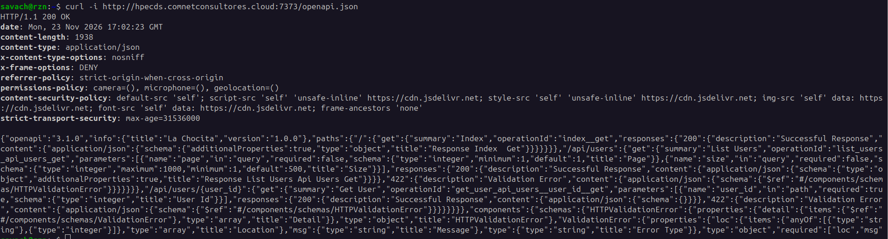
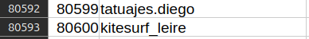
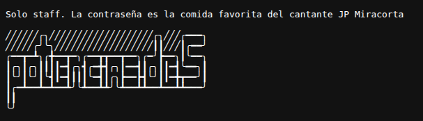
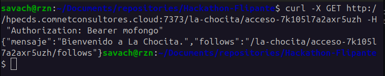
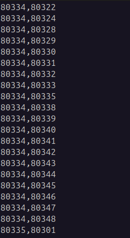

# Hackathon-Flipante

## RETO 1 (Puerto Rico - La Chocita)

### Reconocimiento inicial
Este reto consiste en analizar la red de datos de la plataforma social **Eidolon** para seleccionar al grupo ideal de invitados VIP para el concierto de J.P. Miracorta en San Juan, Puerto Rico.

Para resolver el desafío y presentar la solución correcta, se debe analizar lo siguiente:

* **Identificar conexiones de confianza entre personas:** Analizar el core de datos de Eidolon para encontrar grupos de entre **5 y 10 personajes públicos** en los que exista **seguimiento mutuo entre todos** sus integrantes, es decir que cada miembro debe seguir y ser seguido por todos los demás del grupo.

* **Maximizar el alcance único:** Evaluar qué combinación válida de invitados atrae a la mayor cantidad de seguidores distintos en total, teniendo en cuenta que si un fan sigue a varios invitados del grupo, solo debe contabilizarse una vez.

Para ello nos disponen de una página con los datos core de Eidolon, con el fin de acceder a ellos en mediante direcciones en la URL:

Dirección: http://hpecds.comnetconsultores.cloud:7373/

El primer reto que se puede divisar es que no nos dan el endpoint para acceder a los datos de followers, y aparece el mensaje "solo personal autorizado". En cuanto al contenido de los otros 2 endpoints, encontramos que la primera (/api/users) nos da un listado en formato json de los usuarios. Sin embargo solo lista a 500 usuarios, lo cual difiere a la cantidad de usuarios que dice tener Eidolon. La pista de que no son todos los usuarios no las da primeramente el segundo endpoint (/api/users/{id}) en el aparecían más usuarios al colocar un id mayor a 500.

### Inspección de los encabezados HTTP
Para esta segunda fase, gracias a la pista número dos: 

"Cuando un servidor devuelve 'datos restringidos', la información útil a veces viaja por vías distintas al cuerpo del mensaje... aprende a decodificarlo" 

Se dedujo que había que buscar algo en los encabezados al inspeccionar los distintos endpoints. En el endpoint raiz no encontramos nada, tampoco en el endpoint de /api/users. Ya para el endpoint /api/users/{id} concluímos que para darle una inspección completa necesitaríamos una automatización para leer cada uno de los 80600 usuarios y buscar alguna anomalía en sus cabeceras HTTP.

Tambien debido a que al acceder a la ruta raiz (http://hpecds.comnetconsultores.cloud:7373/) no devolvía una página web sino un json, se tenía la teoría de que la comunicación cliente servidor se hacía mediante una API REST, lo cual fue confirmado al acceder a la ruta /openapi.json que es el esquema estandar de OpenApi:

De aquí observamos cosas interezantes:

* El nombre de la aplicación es "La chocita" y está en su version 1.0.0
* Solo aparecen 3 rutas que tienen habilitado solo el método GET los cuales son: "/", "/api/users" y "/api/users/{user_id}". Esto es importante porque acá no se menciona de otro endpoint relacionado con followers, como se indica en la raíz.
* Tambien estan las reglas y limites en la paginación, lo cual explica el porque solo cargan 500 usuarios cuando se utiliza el endpoint /api/users.

### Extracción de datos y detección de anomalías
Como se dijo en la fase anterior, para poder darle una inspeccion completa a todos los usuarios, necesitariamos de una automatización. La automatización consta de 2 fases. 

* Realizar un script de python que permita extraer todos los usuarios y cargarlos dentro de .csv
* realizar un conteo de todos los usuarios en el .csv para verificar que no falta ninguno

**Fase de extracción de los usuarios**
Para esta fase implementamos el script /scripts/extracción_usuarios.py que basicamente lo que hace es tomar el ID y el username de cada usuario y meterlos a un CSV con el nombre de usuarios.csv para realizarle un análisis. El principal hallazgo encontrado es que al viajar a la ultima celda en donde se encuentra el id 80600, no damos cuenta que pertenece a la fila 80593 que, sin contar la primera celda en donde están los campos **(id, username)** da un total de 8 filas extraviadas.

### Identificación de los 8 IDs faltantes
Para saber que filas faltan en la lista de usuarios se ejecutó un análisis de integridad sobre usuarios.csv para detectar saltos en la numeración consecutiva del 1 al 80600, todo esto mediante el script **/conteo.py**, el resultado fue el siguiente:

IDs faltantes: [1037, 21952, 32775, 42083, 60579, 78402, 78890, 79291]

Con esto se comprueba que en la lista faltan estos 8 IDs. Para saber el porqué no aparecen, inspeccionamos lo que devuelve el endpoint **/api/users/{id}** con estas IDs.

El resultado de esta inspección reveló que en el acceso a estos usuarios está restringido, en vez de **Id** y **username** aparece el mensaje:

{"error":"Acreditación de staff. Datos restringidos."}

Sin embargo gracias a la segunda pista se encontró que al inspeccionar los encabezados se encontró el siguiente valor:

Se puede observar que el en la parte del final del header existe un valor que aparenta ser un pedazo de código de 8 en total. Al revisarlo y ordenarlo según su posición encontramos los siguientes códigos, el "b64" en el codigo indica que probablemente sea un código codificado en base64:

* 1/8;b64=L2xhLW
* 2/8;b64=Nob2Np
* 3/8;b64=dGEvYW
* 4/8;b64=NjZXNv
* 5/8;b64=LTdrMT
* 6/8;b64=A1bDdh
* 7/8;b64=MmF4cj
* 8/8;b64=V1emg=

Uniendo todos los fracmentos, encontramos el siguiente código: **L2xhLWNob2NpdGEvYWNjZXNvLTdrMTA1bDdhMmF4cjV1emg=**. Al decodificar el código mediante un decodificador de base64 web nos revela el siguiente endpoint:

**/la-chocita/acceso-7k105l7a2axr5uzh**

En el endpoint aparece el siguiente contenido:

### Resolución del acertijo y descubrimiento de credenciales
Al inspeccionar /la-chocita/acceso-7k105l7a2axr5uzh, se encontraron 3 elementos clave:

* Un acertijo en el texto "Solo staff. La contraseña es la comida favorita del cantante JP Miracorta".
* Una pista visual con la frase "**potenciasde5**"
* Esquema de autenticación en cabeceras: www-authenticate: Bearer realm="La Chocita".

En cuanto al elemento 2 la pista es clara, hay que buscar en las IDs que sean potencia de 5, y juntandolo con el elemento 1, lo más probable es que haya alguna pista oculta en esas potencias de 5 para descubrir cuál es la comida favorita de J.P Miracorta. Y en cuanto al esquema de autenticación, investigando nos dimos cuenta que hace parte del protocolo HTTP (RFC 7235), que define el marco de autenticación para el protocolo HTTP/1.1. Este marco indica lo siguiente 

Cabeceras de autenticación:
* WWW-Authenticate: Enviada por el servidor en una respuesta 401.
* Authorization: Enviada por el cliente para proveer sus credenciales.

La respuesta de **Authorization** está estructurada de la siguiente forma:

Authenticate: <ESQUEMA> <TOKEN>

En el header nos dice que el **esquema** para poder proveer las credenciales es **Bearer**. El token, debe ser la contraseña que debemos decifrar mediante los otros 2 elementos, que referente a esto, encontramos las siguientes IDs potencia de 5.

* 5¹ (5): marta.ruiz 
* 5² (25): olga0rtiz 
* 5³ (125): fabiola.lopez
* 5⁴ (625): ofelia.g 
* 5⁵ (3125): noelia.medina
* 5⁶ (15625): gema.iglesias 
* 5⁷ (78125): olivia.perez

Nos percatamos que la palabra secreta es **mofongo**, esto se logró al juntar todas las letras iniciales de cada ID potencia, y al relacionarlo con la pista de la comida favorita de JP Miracorta, resulta que el mofongo es una comida tradicional en la república dominicana. 

#### Respuesta del cliente con la autenticación
Para verificar que sí es la contraseña correcta, nos comunicamos con la página mediante el comando curl usando el método get con una flag que permite enviar la autenticación:

[curl -X GET http://hpecds.comnetconsultores.cloud:7373/la-chocita/acceso-7k105l7a2axr5uzh -H "Authorization: Bearer mofongo"]

Esta fue la respuesta del servidor 

Nos entrega el siguiente endpoint:

**{"mensaje":"Bienvenido a La Chocita.","follows":"/la-chocita/acceso-7k105l7a2axr5uzh/follows"}**

Al aplicar el mismo comando con este endpoint, el servidor empieza a arrojar los datos:

[curl -X GET http://hpecds.comnetconsultores.cloud:7373/la-chocita/acceso-7k105l7a2axr5uzh/follows -H "Authorization: Bearer mofongo"]

